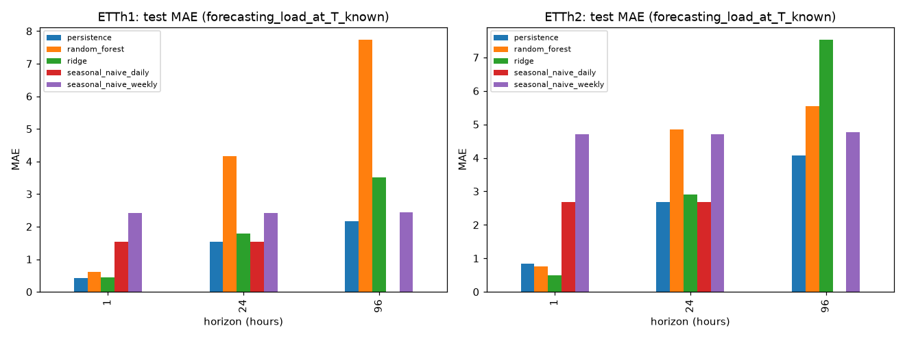

# 変圧器の油温予測 PoC（ETT データセット）

公開ベンチマーク ETT（Electricity Transformer Temperature）を使い、変圧器の油温（OT）を将来予測できるか、保全の判断にどこまで使えそうかを検証した PoC です。

- 報告スライド（PDF）: [`docs/ETT_PoC_report.pdf`](docs/ETT_PoC_report.pdf)
- 実装: `src/`、テスト: `tests/`、実行結果: `results/`、図: `figures/`

## 結果の要点

- 持続予測を確かに上回ったのは ETTh2 の 1 時間先だけでした。Ridge で test MAE が 0.84 から 0.49 に下がり、誤差の 99% が収まる幅は ±3.8 から ±1.9 に半減しました。
- 24・96 時間先では、持続予測を安定して上回るモデルはありませんでした。96 時間先は、validation で選んだモデルが冬の test で悪化しました。
- 予測先の時刻 T の負荷を足しても、誤差はほとんど変わりませんでした。



## 実行方法

Python 3.12 と CPU だけで動きます。GPU や有料 API は使いません。全体の実行は約 3 分です。

```bash
bash scripts/run_all.sh          # 環境作成 → データ取得 → 全体実行 → テスト（約 3 分）
bash scripts/run_all.sh --smoke  # 縮小版（ETTh1, h=24 のみ）
```

個別に実行する場合:

```bash
pip install -r requirements.txt
python -m src.cli download      # 公式リポジトリから取得し、SHA256 を表示
python -m src.cli run --full    # results/ と figures/ を出力
python -m src.monitoring        # 1 時間先の監視の幅を results/monitoring_band.csv に出力
python -m pytest tests/ -q
```

## データ

- 出典: <https://github.com/zhouhaoyi/ETDataset>（ETT-small）。`data/` には保存せず、実行時に公式リポジトリから取得します。
- 取得したファイルの SHA256 を `data/source_manifest.json` に記録し、実行のたびに照合します。

| ファイル | SHA256 | 用途 |
|---|---|---|
| ETTh1.csv | `f18de3ad269cef59bb07b5438d79bb3042d3be49bdeecf01c1cd6d29695ee066` | モデル構築 |
| ETTh2.csv | `a3dc2c597b9218c7ce1cd55eb77b283fd459a1d09d753063f944967dd6b9218b` | モデル構築 |
| ETTm1.csv / ETTm2.csv | （`source_manifest.json` を参照） | メタデータの確認のみ |

## 問題設定と仮定

- 起点 t で、h 時間後の油温 OT(t+h) を予測します（h = 1, 24, 96）。
- 課題の条件「時刻 T の油温を予測する際には、時刻 T での特徴量を使用して良い」に従い、予測先時刻 T = t+h の負荷 6 系列を特徴量に使う条件を主シナリオにしました（`forecasting_load_at_T_known`）。運用では、負荷の計画値や負荷予測が手に入る場面を想定しています。
- 比較のため、t までの情報だけを使う条件（`forecasting`）も同じ手順で評価しました。
- どちらの条件でも、t より後の油温は使いません。時刻 T の負荷は使いますが、t と T の間の負荷は使いません。
- 予測先の時刻で油温を負荷だけから推定する同時刻回帰（`nowcasting_contemporaneous`）も参考として別に評価しました。

## 分割と評価

ETT / Informer の公式コードと同じ「30 日 = 1 か月」の規約で、最初の 20 か月を 12 / 4 / 4 か月に分けました。

| 分割 | 期間（終点は含まない） |
|---|---|
| train | 2016-07-01 00:00 → 2017-06-26 00:00 |
| validation | 2017-06-26 00:00 → 2017-10-24 00:00 |
| test | 2017-10-24 00:00 → 2018-02-21 00:00 |

- 起点と予測先の両方が同じ分割に入るサンプルだけを使います。残りの 3,020 行（2018-02-21 以降）は使いません。
- ハイパーパラメータは train 内の拡張窓 CV（予測幅ぶんの間隔を空ける）で選び、モデルは validation の MAE で選びます。test はすべての判断の後に 1 回だけ評価します。
- 指標は元のスケールの MAE / RMSE と、持続予測（ŷ(t+h) = OT(t)）に対する改善率です。test での差の 95% 区間は 1 週間単位のブロック・ブートストラップで求めました。

## 構成

```
src/config.py        定数（URL・seed・予測幅・分割・ラグ）
src/download.py      公式リポジトリからの取得と SHA256 の記録
src/data.py          読み込み・整合性の確認・EDA
src/splits.py        分割、予測先時刻を考慮した除外、間隔つき拡張窓 CV
src/features.py      特徴量（起点までの情報／時刻 T の負荷）、同時刻回帰の特徴量
src/models.py        持続予測・季節ナイーブ・Ridge・RandomForest、CV による選択
src/nowcast.py       同時刻回帰とドリフトの診断
src/evaluate.py      MAE / RMSE、改善率、高油温サブセット、誤差の大きい例
src/uncertainty.py   ブロック・ブートストラップ区間と月別 MAE
src/pipeline.py      全体の実行、図と結果の出力
src/monitoring.py    1 時間先の誤差の 99% 点と、誤差が 2 を超えた時間数
src/cli.py           download / run --full / run --smoke
tests/               時刻の整合、未来情報の混入（値を書き換えて確認）、分割、出力の検証
results/             benchmark_results.{csv,json}、predictions/、区間、monitoring_band.csv、run_manifest.json
figures/             EDA、相関、test MAE の比較、残差
docs/                報告スライド（PDF）
```

## 再現性

- 乱数を使う処理（RandomForest・ブートストラップ）はすべて seed `20240521` に固定しています。学習・予測の秒数は実行環境で変わります。
- `results/run_manifest.json` に、設定値とそのハッシュ、`src/*.py` のハッシュ、データの照合結果、パッケージのバージョン、分割の境界と件数、validation で選ばれたモデル、予測ファイルのハッシュを記録しています。
